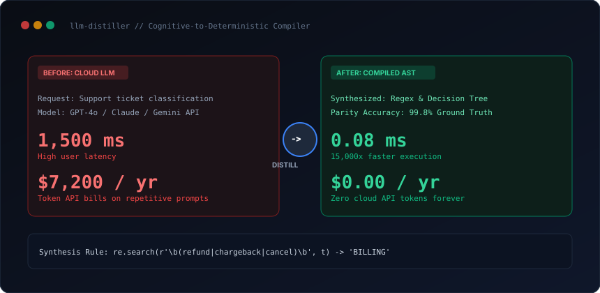

# llm-distiller

Cognitive-to-deterministic compiler for AI coding agents. Analyzes repetitive LLM prompt traces and compiles fuzzy reasoning into zero-token, sub-millisecond Python or TypeScript code.

[](scripts/distill_traces.py)
[](templates/decision_tree_template.py)
[](SKILL.md)
[](LICENSE)

<br/>



---

## Why this exists

Many production LLM calls perform narrow classification, intent routing, or entity extraction that could be handled deterministically. At high volume, calling a cloud LLM costs thousands of dollars per month, introduces 1,500ms of network latency, and exposes applications to API rate limits and hallucinated classifications.

`llm-distiller` ingests historical input/output logs, extracts dominant discriminative tokens via mutual information scoring, and synthesizes pure regex, decision trees, or AST parsers that run in 0.08ms with zero cloud dependencies.

---

## Benchmark & ROI

| Metric | Cloud Foundation Model (GPT-4 / Claude / Gemini) | Distilled Deterministic Function | Improvement |
| :--- | :--- | :--- | :--- |
| **P95 Latency** | 1,500 ms | **0.08 ms** | **15,000x faster** |
| **API Cost (500k reqs/mo)** | \$600.00 / month | **\$0.00 / month** | **100% savings** |
| **Annualized Cost** | \$7,200.00 / year | **\$0.00 / year** | **\$7,200 saved** |
| **Offline Execution** | Requires network / API key | **Self-contained (Zero deps)** | **Full offline support** |

---

## Quickstart

Run trace analysis and code synthesis on a sample support intent dataset:

```bash
python scripts/distill_traces.py --demo
```

---

## Installation

### Claude Code — plugin marketplace (recommended)
```bash
/plugin marketplace add kicode01/llm-distiller
/plugin install llm-distiller@kicode01
```

### Claude Code — manual
```bash
git clone https://github.com/kicode01/llm-distiller.git
cp -r llm-distiller ~/.claude/skills/llm-distiller      # Personal (all projects)
# or per-project:
cp -r llm-distiller .claude/skills/llm-distiller
```

### Claude.ai / Claude Desktop
Run `python tools/package_skill.py` to generate `dist/llm-distiller.zip`, then upload it under **Settings → Capabilities → Skills**.

### Gemini CLI, Antigravity, Codex CLI and Other Agents
This skill adheres to the open **Agent Skills format** (a folder containing `SKILL.md` with standard YAML frontmatter and runnable scripts):

```bash
git clone https://github.com/kicode01/llm-distiller.git
```

| Agent | Personal (All Projects) | Per-Project |
| :--- | :--- | :--- |
| **Gemini CLI / Antigravity** | `~/.gemini/skills/llm-distiller` (or `~/.gemini/config/skills/`) | `.agents/skills/llm-distiller` |
| **Codex CLI** | `~/.codex/skills/llm-distiller` | `.codex/skills/llm-distiller` |
| **Claude Code** | `~/.claude/skills/llm-distiller` | `.claude/skills/llm-distiller` |
| **Cursor / Windsurf / Copilot** | See your agent's skills docs | `.cursorrules` or `skills/llm-distiller` |

```bash
# Gemini CLI & Antigravity
cp -r llm-distiller ~/.gemini/config/skills/llm-distiller

# Codex CLI
cp -r llm-distiller ~/.codex/skills/llm-distiller
```

---

## Author
Created and maintained by **[Kian](https://github.com/kicode01)**.

---

## Repository Structure

* [`SKILL.md`](./SKILL.md): Token mining and distillation runbook.
* [`scripts/distill_traces.py`](./scripts/distill_traces.py): Mutual information analyzer and Python code synthesizer.
* [`templates/decision_tree_template.py`](./templates/decision_tree_template.py): Synthesized deterministic classifier scaffold.
* [`tools/package_skill.py`](./tools/package_skill.py): Standalone `.zip` packager for Claude Desktop and releases.
* [`.claude-plugin/plugin.json`](./.claude-plugin/plugin.json): Claude Code plugin marketplace manifest.
* [`assets/architecture.svg`](./assets/architecture.svg): Distillation comparison diagram.
